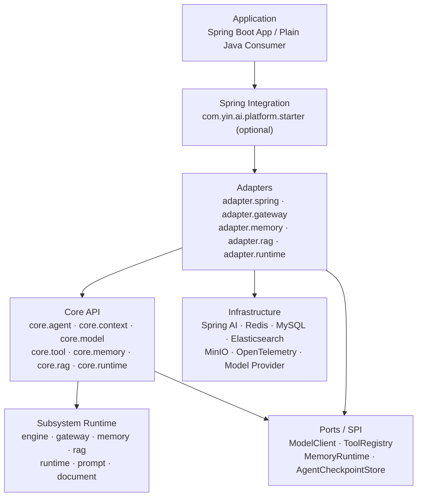
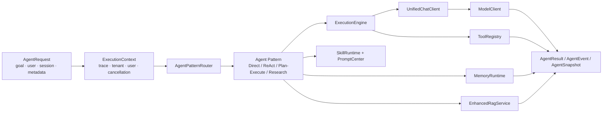
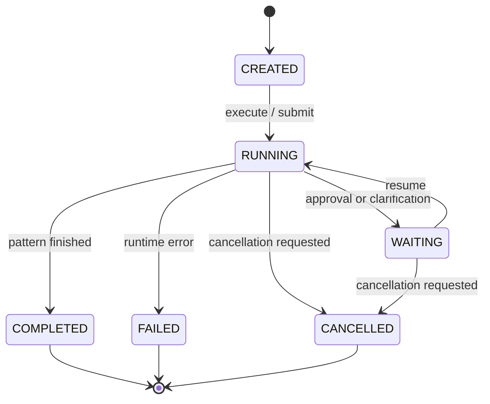
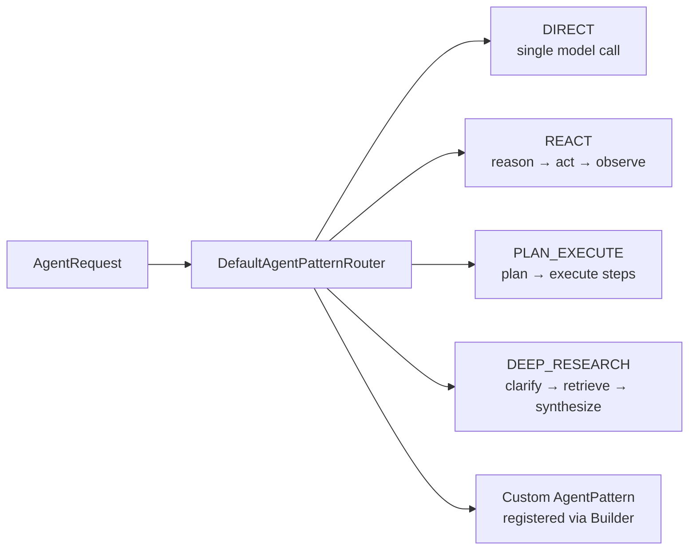

# Open Platform

<p align="center">
  <strong>Framework-neutral AI runtime and infrastructure for Java</strong>
</p>

<p align="center">
  <a href="README.md">中文文档</a>
  ·
  <a href="architecture-overview.md">Architecture overview</a>
  ·
  <a href="examples/code-qa/README.md">Consumer example</a>
  ·
  <a href="LICENSE">MIT License</a>
</p>

<p align="center">
  
  
  
  
</p>

Open Platform is a framework-neutral AI infrastructure library. It turns agent orchestration,
model invocation, tools, execution, memory, RAG, skills, prompts, functions, checkpoints,
human-in-the-loop approval and observability into composable Java APIs.

The Core API does not depend on Spring and runs in a plain Java program. Spring Boot, Spring AI,
Redis, LangChain4j, PDFBox, Apache POI and OpenTelemetry are wired in through optional dependencies
and adapters. Spring Boot auto-configuration lives in `com.yin.ai.platform.starter`; business
interfaces and persistence belong to the consuming application.

> This project was extracted from the WKC News Cloud monolith and is now a **self-contained Maven
> build**: no parent outside this repository, no dependency on host modules. The identity and
> security types that used to come from a shared `wkc-common` module are vendored into
> `com.yin.domain` / `com.yin.security` — see [Compatibility & migration](#compatibility--migration).

> New code should target `com.yin.ai.platform.quickstart.*` for the facade or
> `com.yin.ai.platform.core.*` for the canonical API. `com.yin.ai.platform.agent.*` is the legacy
> orchestration API and a compatibility layer that is being converged into the Core API.

## Table of contents

- [Positioning and boundaries](#positioning-and-boundaries)
- [Capability overview](#capability-overview)
- [What is implemented today](#what-is-implemented-today)
- [Roadmap](#roadmap)
- [Architecture](#architecture)
- [Module layout](#module-layout)
- [Quick start](#quick-start)
- [Spring Boot integration](#spring-boot-integration)
- [Core subsystems](#core-subsystems)
- [Extension points](#extension-points)
- [Configuration](#configuration)
- [Directory structure](#directory-structure)
- [Build, test and examples](#build-test-and-examples)
- [Compatibility & migration](#compatibility--migration)
- [Production checklist](#production-checklist)
- [Known limitations](#known-limitations)
- [Contributing & license](#contributing--license)

## Positioning and boundaries

### What this library does

- Provides a framework-neutral Agent Runtime, agent patterns, Model Port, Tool Port and
  Execution Context.
- Provides a unified model gateway, function/tool registry, skill runtime, prompt center,
  memory runtime and RAG pipeline.
- Provides synchronous, asynchronous, parallel, streaming, timeout, retry, cancellation,
  checkpoint and event boundaries.
- Provides human approval, research clarification, structured output, feature flags, tracing,
  metrics and RAG/Memory evaluation.
- Connects to Spring, Redis, MySQL, Elasticsearch, MinIO, LangChain4j and concrete model
  providers through SPI and adapter packages.

### What this library does not do

- It does not own any business domain's users, content, permissions, publishing or database tables.
- It does not hard-code model providers, business permissions or tenant policies in the Core Runtime.
- It does not encourage business code to hold a `ChatClient`/`ChatModel` or to create extra thread pools.
- It does not host the consuming application's controllers, DTOs, audit tables or workflow
  implementations inside the platform core.

## Capability overview

| Subsystem | Responsibility | Recommended entry point |
| --- | --- | --- |
| Core Agent Runtime | Agent lifecycle, sync/async execution, cancellation, snapshot, resume, instruction injection | `core.agent.AgentRuntime` |
| Agent Patterns | DIRECT, REACT, PLAN_EXECUTE, DEEP_RESEARCH orchestration policies | `core.agent.pattern` |
| Model Port | Provider-neutral, unified sync and streaming model calls | `core.model.ModelClient` |
| Tool Port | Tool description, registration, selection and execution | `core.tool.ToolRegistry` |
| Execution Engine | Threading, context propagation, timeout, retry, parallelism, streaming | `engine.ExecutionEngine` |
| AI Gateway | Unified chat/stream, filter chain, fallback, cost, tracing | `gateway.UnifiedChatClient` |
| Memory | Working, Session, Episodic, Semantic, Procedural memory | `core.memory.api.MemoryRuntime` |
| RAG | Document ingestion, chunking, embedding, hybrid retrieval, RRF, reranking, grounding | `rag.EnhancedRagService` |
| Skill | Skill loading, intent selection, dependency resolution, execution | `runtime.SkillRuntime` |
| Prompt | Templates, fragments, variables, versioning | `prompt.PromptCenter` |
| Governance | HITL approval, checkpoints, clarification, policy, feature flags | `core.agent.approval` / `config` |
| Observability | Traces, metrics, audit, online quality sampling, evaluation | `observe` |

## What is implemented today

| Area | Current implementation |
| --- | --- |
| Agent execution | DIRECT, REACT, PLAN_EXECUTE and DEEP_RESEARCH built-in modes; synchronous execution, asynchronous submission, cancellation, snapshots, event listeners and instruction injection. |
| Agent governance | Checkpoints, pause/resume, human approval, research clarification, step limits, structured results and failure-policy boundaries. |
| Models and tools | Model and tool providers isolated behind `ModelClient` and `ToolRegistry`; tool description, registration, selection and invocation. |
| Execution engine | Sync, async, parallel, streaming, timeout, cancellation, retry, backoff and `ExecutionContext` propagation. |
| AI Gateway | Single `chat`/`chatStream` entry point carrying retry, fallback, tracing, metrics, caching and safety filters. |
| Memory | Working, Session, Episodic, Semantic and Procedural memory, plus timeline, hybrid retrieval, snapshots, updates, deletion and statistics. |
| RAG and documents | Text/PDF/Office parsing, chunking, embedding, vector and BM25 retrieval, RRF fusion, reranking, context assembly and grounding. |
| Skills and prompts | Skill loading, intent selection, dependency resolution, prompt templates, fragments, variables and skill-to-function bridging. |
| Observability and evaluation | Trace spans, metrics, audit, online quality sampling and RAG/Memory retrieval evaluation. |
| Spring integration | Spring Boot auto-configuration plus Redis, JDBC, vector store and model gateway adapters; the Core API still works without Spring. |

## Roadmap

The following roadmap is non-binding; priority follows feedback and stability needs.

| Horizon | Direction | Planned work |
| --- | --- | --- |
| Near | Core API convergence | Tighten the Core API contracts and reduce new code depending on the legacy `agent` package. |
| Near | Production task runtime | Durable task state, distributed checkpoints, event replay, resumable idempotency and multi-instance coordination. |
| Mid | Memory hardening | Redis/MySQL/vector store adapters, TTL, archival, consolidation, forgetting, tenant isolation and sensitive-data governance. |
| Mid | RAG engineering | Async indexing, document permission filtering, incremental updates, offline datasets, online quality evaluation and multi-knowledge-base management. |
| Mid | Agent governance | Quotas, cost budgets, tool permission models, HITL policies, SLOs, circuit breaking and cross-service tracing. |
| Long | Ecosystem | More model/vector-store/object-store adapters, runnable examples, starter simplification and better documentation. |

## Architecture

### 1. Layering and dependency direction

The platform uses four layers: Core, Port, Adapter and Application. Dependencies point from the
application toward the adapters, and adapters implement the ports that Core requires. Core never
depends on business services.



### 2. Runtime request architecture



### 3. Agent lifecycle



### 4. Agent pattern selection



### 5. Async, pause and resume

`AgentRuntime.submit` returns an `AgentRun` handle immediately. `AgentRun.completion()` yields the
final `AgentResult`. `AgentEventListener` receives lifecycle events. Patterns that require approval
or clarification transition to `WAITING` and resume through `AgentRuntime.resume` with the
checkpoint store providing the persisted state.

### 6. Components and external resources

| Component | External resource | Optional |
| --- | --- | --- |
| `ModelClient` | OpenAI-compatible model provider | yes |
| `ToolRegistry` | in-process | no |
| `MemoryRuntime` | Redis / in-memory / vector store | yes |
| `EnhancedRagService` | Elasticsearch + embedding model | yes |
| `PromptCenter` | classpath YAML | no |
| `SkillRuntime` | classpath Markdown | no |
| `TraceStore` | in-memory / Elasticsearch | yes |
| Config | `application.yaml`, environment variables | yes |

## Core Agent Runtime

The Core Agent Runtime is the canonical, framework-neutral entry point:

```java
AgentRuntime runtime = DefaultAgentRuntime.builder()
        .model(modelClient)
        .tools(toolRegistry)
        .build();

AgentResult result = runtime.execute(
        AgentRequest.of("Summarize today's filings", "user-1", "session-1", context));
```

Key types:

| Type | Responsibility |
| --- | --- |
| `AgentRequest` | goal, user, session, metadata, system prompt, model, temperature, `ExecutionContext` |
| `AgentResult` | task id, status, output, error, metadata |
| `AgentRun` | asynchronous handle with `taskId`, `completion()`, `cancel()` |
| `AgentSnapshot` | serializable run state for resume |
| `AgentEventListener` | push-based lifecycle events |
| `AgentPatternRouter` | selects the orchestration policy |

## Quick start

### Plain Java

```java
import com.yin.ai.platform.quickstart.Agent;
import com.yin.ai.platform.quickstart.ModelClients;
import com.yin.ai.platform.quickstart.Result;

// Register the model client once (Spring Boot apps get one auto-registered).
ModelClients.register(myModelClient);

Agent agent = Agent.of("Content review")
        .prompt("Decide whether the input violates the community rules. "
                + "Answer PASS or REJECT plus one sentence.")
        .build();

Result result = agent.run(articleText);
System.out.println(result.ok() + " " + result.text());
```

That is the whole business surface: `Agent` and `Result`. No `ExecutionContext`, no trace id, no
`AgentRequest`, no `ToolRegistry` setup.

### Streaming

`Agent.stream(input)` returns a `Flux<Result>`; each `Result` carries an incremental delta
(`result.delta() == true`). Streaming requires Reactor, which is why the facade lives in its own
module rather than in `core`.

### Tool registration

```java
ToolRegistry tools = new DefaultToolRegistry();
tools.register(myTool);

Agent agent = Agent.of("Code Q&A")
        .prompt("Answer questions about this codebase. Call search_code first.")
        .tools(tools)
        .build();
```

When a tool registry is present the facade routes to the REACT pattern; the default DIRECT pattern
performs a single model call and does not consume `toolCalls`.

## Spring Boot integration

### Dependency

```xml
<dependency>
    <groupId>com.yin</groupId>
    <artifactId>open-platform-server</artifactId>
    <version>0.0.1-SNAPSHOT</version>
</dependency>
```

`open-platform-server` transitively brings in `open-platform` (the implementation) plus
`open-platform-core` and `open-platform-quickstart`. The platform marks its third-party
dependencies `optional`, so **the application must declare what it actually uses**
(Spring Web, Redisson, LangChain4j, etc.).

### Auto-configuration

Auto-configuration entries are declared in
`META-INF/spring/org.springframework.boot.autoconfigure.AutoConfiguration.imports` inside the
`server` module. A Spring application can:

1. Add the `open-platform-server` dependency.
2. Configure Spring AI, Redis, database, RAG and observability resources.
3. Override any default implementation with `@ConditionalOnMissingBean`.

### Boundary between Spring and Core

| Concern | Owner |
| --- | --- |
| Bean assembly, `@ConfigurationProperties` | `server` module |
| Security filters, JWT, sensitive words | `security` module |
| Redis/Elasticsearch/JDBC implementations | `platform` module (`adapter.*`) |
| Agent patterns, model/tool ports | `core` module |

## Core subsystems

### 1. Execution Engine

`ExecutionEngine` provides sync, async, parallel, streaming and retry execution. Every call is
bounded by `ExecutionOptions.timeout()`: the task runs on a dedicated virtual thread and the caller
awaits with `Future.get(timeout)`, cancelling the worker on timeout. MDC and `SecurityContext` are
injected and cleared on the worker thread only, never on the caller's thread.

### 2. Memory

| Type | Lifetime | Storage |
| --- | --- | --- |
| `WORKING` | session (1h) | L1 heap |
| `EPISODIC` | 7 days | Redis Stream / timeseries |
| `SEMANTIC` | 365 days | Vector store + MySQL |
| `PROCEDURAL` | 365 days | MySQL |
| `SESSION` | 30 min | Redis list (deprecated; writes go to `EPISODIC` with a session scope) |

Retrieval runs keyword, vector and hybrid routes fused with RRF, followed by eligibility checks and
confidence weighting.

### 3. RAG and the document pipeline

Six-stage retrieval: query rewriting → multi-route retrieval (vector + BM25) → RRF fusion → LLM
reranking → context assembly → injection. The document pipeline covers source → detector → parser →
cleaner → splitter → AST.

### 4. Skills, prompts and functions

Skills are Markdown files with YAML frontmatter (name, version, model, temperature, intent,
dependencies). The prompt center manages templates, fragments and variables. The function registry
exposes tools to the model.

### 5. AI Gateway

`UnifiedChatClient` is the single place that talks to a model provider. Filters cover input guard,
tenant context, cache, quota, rate limit, fallback, retry, metrics, tracing, health, audit, cost and
output guard, terminating in the provider adapter.

### 6. Governance and observability

Checkpoints, approval policies, clarification, feature flags, trace spans, metrics, audit entries,
online quality sampling and RAG/Memory evaluation.

## Extension points

| Extension point | Interface |
| --- | --- |
| Model provider | `core.model.ModelClient` |
| Tool | `core.tool.Tool` + `ToolRegistry` |
| Agent pattern | `core.agent.pattern.AgentPattern` |
| Planner / reflector / observer | `agent.planner.Planner`, `agent.reflector.Reflector`, `agent.observer.Observer` |
| Memory store | `core.memory.store.*` |
| Document parser / splitter | `document.parser.DocumentParser`, `document.splitter.ChunkSplitter` |
| Checkpoint store | `core.agent.checkpoint.AgentCheckpointStore` |
| Trace store | `observe.TraceStore` |

### Custom agent pattern

Implement `AgentPattern`, expose it as a bean (Spring) or register it on the runtime builder
(plain Java). See `com.yin.ai.platform.core.agent.pattern` for the built-in implementations.

## Configuration

### Maven

```bash
mvn -DskipTests package     # build all modules
mvn test                    # run all tests
mvn verify                  # full verification
```

Platform dependencies are declared `optional`; consumers must add the adapters they use.

### Configuration areas

| Prefix | Purpose |
| --- | --- |
| `ai.engine` | default timeout, LLM timeout, function timeout, retry, thread pool |
| `ai.gateway` | default model, temperature, max tokens, filters, thinking mode |
| `ai.memory` | TTL, orchestration, retrieval, writes, archival, consolidation |
| `ai.rag` / `ai.knowledge` | Elasticsearch, embedding, index, context limits |
| `ai.skill` | intent-to-skill mapping |
| `ai.observability` | tracing and online retrieval-quality sampling |
| `ai.feature` | streaming, checkpoint, async, quota and concurrency switches |

Secrets must come from environment variables or the deployment platform, never from committed files.

## Module layout

Modules are ordered bottom-up; the dependency graph is a single acyclic chain.

```text
core ─┬─> document ─┐
      ├─> security ─┤
      ├─> rollout ──┼─> platform ─┬─> legacy
      └─> quickstart ┘             └─> server
```

| Module | Coordinates | Contents | Files | Tests |
| --- | --- | --- | ---: | ---: |
| Core | `com.yin:open-platform-core` | Framework-neutral contracts: Agent Runtime, four patterns, Model/Tool/Memory/RAG ports, `ExecutionContext`, minimal identity types | 175 | 120 |
| Document | `com.yin:open-platform-document` | Parsing (PDF/DOCX/XLSX/PPTX/HTML/Markdown/TXT), cleaning, chunking, AST | 56 | 103 |
| Security | `com.yin:open-platform-security` | JWT filter, sensitive-word DFA, internal API HMAC, security chain, feature flags | 15 | — |
| Rollout | `com.yin:open-platform-rollout` | Rollout switches | 2 | 1 |
| Quickstart | `com.yin:open-platform-quickstart` | Business facade: `Agent` / `Result` / `ModelClients` | 3 | 8 |
| Platform | **`com.yin:open-platform`** | Agent orchestration, gateway, engine, memory, RAG, function, prompt, workflow, observability, adapters | 662 | 1066 |
| Legacy | `com.yin:open-platform-legacy` | V1 → V2 migration bridge | 2 | — |
| Server | `com.yin:open-platform-server` | Spring Boot auto-configuration entry | 10 | 21 |

**Which artifact to depend on:**

```xml
<!-- Plain Java, or when the facade is needed -->
<dependency>
    <groupId>com.yin</groupId>
    <artifactId>open-platform</artifactId>
    <version>0.0.1-SNAPSHOT</version>
</dependency>
<dependency>
    <groupId>com.yin</groupId>
    <artifactId>open-platform-quickstart</artifactId>
    <version>0.0.1-SNAPSHOT</version>
</dependency>
```

```xml
<!-- Spring Boot applications: pulls in core / platform / quickstart -->
<dependency>
    <groupId>com.yin</groupId>
    <artifactId>open-platform-server</artifactId>
    <version>0.0.1-SNAPSHOT</version>
</dependency>
```

## Directory structure

```text
open-platform/
├── pom.xml                     # parent POM (packaging=pom)
├── README.md                   # Chinese documentation
├── README.en.md                # this file
├── architecture-overview.md
├── config/checkstyle/          # optional lint configuration (-Plint)
├── examples/
│   ├── pure-java/              # minimal usage without Spring
│   └── code-qa/                # real consumer: codebase Q&A assistant
├── core/src/main/java/
│   ├── com/yin/ai/platform/
│   │   ├── core/               # canonical API, context, model, tool, four patterns
│   │   └── exception/
│   ├── com/yin/domain/         # identity types (LoginUser / User)
│   └── com/yin/security/util/  # GetLoginUserUtil / UserContext / InternalApiSignUtils
├── document/src/main/java/com/yin/ai/platform/document/
├── security/src/main/java/
│   ├── com/yin/ai/platform/{filter,config}/
│   └── com/yin/security/filter/          # InternalApiFilter
├── rollout/src/main/java/com/yin/ai/platform/rollout/
├── quickstart/src/main/java/com/yin/ai/platform/quickstart/
├── platform/src/main/java/com/yin/ai/platform/
│   ├── agent/ engine/ gateway/ memory/ rag/ function/ runtime/
│   ├── prompt/ observe/ workflow/ structured/ knowledge/
│   └── adapter/                # Spring, Redis, JDBC, vector store adapters
├── platform/src/main/resources/prompts/
├── legacy/src/main/java/com/yin/ai/platform/legacy/
└── server/
    ├── src/main/java/com/yin/ai/platform/starter/
    └── src/main/resources/META-INF/spring/  # AutoConfiguration imports
```

## Build, test and examples

### Compile and unit test

```bash
# Build all modules
mvn -DskipTests package

# Run every module's unit tests (currently 1319)
mvn test

# Build one module and its upstream dependencies
mvn -pl platform -am test

# Full verification (JaCoCo data is only produced with -Pcoverage)
mvn verify
```

Test distribution: `core` 120, `document` 103, `platform` 1066, `server` 21,
`quickstart` 8, `rollout` 1.

### Plain Java smoke test

`examples/pure-java` uses a `MockModelClient` to verify that:

- the Core API requires no Spring;
- `ExecutionContext` can carry caller, operation and trace;
- `DefaultToolRegistry` works outside a container;
- `DefaultAgentRuntime` completes a minimal agent run;
- platform infrastructure dependencies do not drag Spring onto a plain Java classpath.

```bash
mvn install -DskipTests
mvn -f examples/pure-java/pom.xml verify
```

### Real consumer example (code-qa)

`examples/code-qa` is an independent consumer with no relation to the news domain. It doubles as the
acceptance test for "is the abstraction actually usable outside one business case?", and it runs
offline with a deterministic stub model so CI needs no API key.

```bash
mvn install -DskipTests
mvn -f examples/code-qa/pom.xml verify
```

On Windows you can also run `examples\code-qa\run.cmd`. See
[examples/code-qa/README.md](examples/code-qa/README.md) for details and for the platform gaps that
building this consumer exposed.

### Coverage gate

```bash
mvn verify -Pcoverage-gate
```

> Coverage is off by default. The JaCoCo agent fails to load when the build lives under a non-ASCII
> path (for example a desktop folder with a Chinese username) because the `destfile` path cannot be
> encoded for `-javaagent`, crashing the forked JVM. Enable it explicitly with `-Pcoverage` or
> `-Pcoverage-gate`.

### Lint

```bash
# Optional lint: inherits the host project's Checkstyle config. Existing violations
# have not been cleaned up, so this reports without failing the build.
mvn -Plint verify

mvn test
git diff --check
```

## Compatibility & migration

### Decoupling from the host project (vendored types)

This project used to be one module inside a larger multi-module Maven build and obtained its
identity and security types from a shared `wkc-common` module. To become self-contained, the
following six types are now vendored into this repository:

| Type | Package | Note |
| --- | --- | --- |
| `LoginUser` | `com.yin.domain` | logged-in user, implements Spring Security `UserDetails` |
| `User` | `com.yin.domain` | generic user model; **MyBatis-Plus `@TableName` removed**, the platform has no ORM dependency |
| `GetLoginUserUtil` | `com.yin.security.util` | reads the current user from the security context |
| `UserContext` | `com.yin.security.util` | `ScopedValue`-based user context |
| `InternalApiSignUtils` | `com.yin.security.util` | HMAC-SHA256 signing for internal APIs |
| `InternalApiFilter` | `com.yin.security.filter` | signature verification for `/internal/**` |

Package names are unchanged, so migrating the original host project requires nothing more than
switching the Maven coordinates.

Side effect: the transitive dependencies those types used to pull in (hutool, sentinel-core, jjwt,
hibernate-validator, uap-java, commons-pool2 and others) disappeared from the dependency tree.
Platform code was verified not to reference them — Sentinel only appears as a *forbidden package
name* string inside an ArchUnit rule — so this is a net reduction in dependency surface.

### Deliberately retained legacy identifiers

The following identifiers still carry a `wkc-` prefix on purpose. They are either external
persistence/observability contracts or runtime switches, and renaming them would break compatibility:

| Location | Identifier | Impact of renaming |
| --- | --- | --- |
| `RAGProperties` | default Elasticsearch index `wkc-documents` | retrieval silently returns nothing against existing indices |
| `ElasticsearchMemorySearchService` | index `wkc-memory-cells` | historical memory becomes unreadable |
| `ElasticsearchTraceStore` | index `wkc-trace-spans` | existing traces become unqueryable |
| `PlanToolGenerator` | system property `wkc.agent.planner.toolCall` | existing deployments lose the switch |
| `AiTracingService`, `AgentPatternConfiguration` | tracer names `wkc-ai-platform*` | dashboards and metric names break |

If renaming is required, treat it as an explicit breaking change with configuration override and a
data-migration plan.

### Two API surfaces

| API | Role | Guidance |
| --- | --- | --- |
| `com.yin.ai.platform.quickstart.*` | minimal facade (`Agent` / `Result`) | **preferred for business code**; no platform internals needed |
| `com.yin.ai.platform.core.*` | framework-neutral canonical API | use when fine control is required |
| `com.yin.ai.platform.agent.*` | legacy Agent Runtime, Planner, Reflector, HITL and adapter API | maintain existing code, migrate gradually |
| `com.yin.ai.platform.adapter.runtime.persistence.*` | Redis implementations of agent state, task context, tokens and HITL | infrastructure implementations live here |
| `com.yin.ai.platform.adapter.runtime.event.*` | Redis event log, replay cursor and realtime distribution | runtime infrastructure, no HTTP types |
| `com.yin.ai.platform.adapter.spring.web.*` | SSE/HTTP transport and Spring Security wiring | Spring Web consumers only |

## Production checklist

- [ ] Define explicit permission boundaries for `ModelClient`, tools, skills and MCP tools.
- [ ] Enable `ApprovalPolicy`, HITL and audit for high-risk write operations.
- [ ] Enable Redis `AgentRunStore` and `AgentCheckpointStore`, or supply your own persistence.
- [ ] Design tenant and user isolation for tasks, events, artifacts, memory and RAG documents.
- [ ] Configure timeouts and fallbacks for model calls, tool calls, RAG retrieval and memory recall.
- [ ] Configure pools, credentials and health checks for Redis, MySQL, Elasticsearch, MinIO and the model API.
- [ ] Monitor tokens, cost, latency, error rate, cancellation rate, tool failure rate and retrieval quality.
- [ ] Version and roll back prompts, skills, models and feature flags.
- [ ] Enforce size, type and content limits on uploaded documents, external pages, MCP resources and model output.
- [ ] Continuously evaluate RAG/Memory quality with offline datasets and online sampling.

## Known limitations

- The default `DefaultAgentRuntime` keeps run state and checkpoints in memory; suitable for
  development and testing, switch to the Redis adapter for production.
- The Core Runtime keeps an extension boundary for multi-agent subtask management; task persistence
  and quotas are the consuming application's responsibility.
- RAG, memory, Redis, Elasticsearch, MinIO and model capabilities are optional infrastructure; when
  absent, explicit fallbacks apply.
- The legacy `agent` package and the Core API coexist; part of the code is still migrating. Avoid
  expanding direct dependencies on the legacy API in new modules.
- Upgrades should check Spring Boot / Spring AI compatibility, configuration format and external
  vector index schema.
- Coverage collection is disabled by default (see [Build, test and examples](#build-test-and-examples));
  enable it with `-Pcoverage`.

## Contributing & license

Issues, documentation improvements and pull requests are welcome. Before submitting:

- Use Java 21 and respect the Checkstyle configuration.
- Add unit tests with each change; add controlled integration tests when external dependencies are involved.
- Do not commit `.env`, secrets, logs, `target` or local IDE files.
- Describe the background, approach, test commands and known limitations in the pull request.

Licensed under the [MIT License](LICENSE).

Copyright (c) 2026 whosayyy.
