# Open Platform

<p align="center">
  <strong>Framework-neutral AI runtime and infrastructure for Java</strong>
</p>

<p align="center">
  <a href="README.en.md">English</a>
  ·
  <a href="architecture-overview.md">详细架构说明</a>
  ·
  <a href="examples/code-qa/README.md">消费者示例</a>
  ·
  <a href="LICENSE">MIT License</a>
</p>

<p align="center">
  
  
  
</p>

Open Platform 是一个框架无关的 AI 基础设施库。它将 Agent 编排、模型调用、工具、执行引擎、记忆、RAG、Skill、Prompt、Function、检查点、人工审批和可观测性抽象成可组合的 Java API。

平台的 Core API 不依赖 Spring，可以直接在普通 Java 程序中运行。Spring Boot、Spring AI、Redis、LangChain4j、PDFBox、Apache POI、OpenTelemetry 等基础设施通过可选依赖和适配器接入。Spring Boot 自动配置位于 `com.yin.ai.platform.starter`，业务接口与持久化实现应由消费方应用自行提供。

> 本项目从 WKC News Cloud 宿主工程中抽出，是一个**自治的 Maven 项目**：没有 parent、不依赖宿主工程的任何模块。原先通过 `wkc-common` 获取的身份与安全类型已内联到 `com.yin.domain` / `com.yin.security` 包中，详见[兼容性与迁移](#兼容性与迁移)。

> 推荐新代码使用 com.yin.ai.platform.core.*。com.yin.ai.platform.agent.* 是历史编排 API 和兼容层，正在逐步收敛到 Core API。

## 目录

- [定位与边界](#定位与边界)
- [能力总览](#能力总览)
- [当前具备的能力](#当前具备的能力)
- [未来规划](#未来规划)
- [架构](#架构)
- [Core Agent Runtime](#core-agent-runtime)
- [快速使用](#快速使用)
- [Spring Boot 集成](#spring-boot-集成)
- [核心子系统](#核心子系统)
- [扩展点](#扩展点)
- [配置与依赖](#配置与依赖)
- [目录结构](#目录结构)
- [构建、测试与示例](#构建测试与示例)
- [兼容性与迁移](#兼容性与迁移)
- [生产使用检查清单](#生产使用检查清单)
- [已知限制](#已知限制)
- [贡献与许可证](#贡献与许可证)

## 定位与边界

### 这个模块负责什么

- 提供框架无关的 Agent Runtime、Agent Pattern、Model Port、Tool Port 和 Execution Context。
- 提供统一的模型 Gateway、Function/Tool Registry、Skill Runtime、Prompt Center、Memory Runtime 和 RAG Pipeline。
- 提供同步、异步、并行、流式、超时、重试、取消、检查点和事件边界。
- 提供人工审批、研究澄清、结构化输出、Feature Flag、Trace、Metrics 和 RAG/Memory 评测能力。
- 通过 SPI 和 adapter 包连接 Spring、Redis、MySQL、Elasticsearch、MinIO、LangChain4j 和具体模型供应商。

### 这个模块不负责什么

- 不负责具体业务域的用户、内容、权限、文章发布和数据库表。
- 不在 Core Runtime 中硬编码具体模型供应商、业务用户权限或业务租户策略。
- 不建议业务代码直接持有 ChatClient、ChatModel 或自行创建并行线程池。
- 不把宿主应用的 Controller、DTO、审计表和业务工作流实现放入平台核心。

## 能力总览

| 子系统 | 职责 | 推荐入口 |
| --- | --- | --- |
| Core Agent Runtime | Agent 生命周期、同步/异步运行、取消、快照、恢复、指令注入 | core.agent.AgentRuntime |
| Agent Patterns | DIRECT、REACT、PLAN_EXECUTE、DEEP_RESEARCH 编排策略 | core.agent.pattern |
| Model Port | 屏蔽模型供应商，统一同步与流式模型调用 | core.model.ModelClient |
| Tool Port | 工具描述、注册、选择和执行 | core.tool.ToolRegistry |
| Execution Engine | 线程池、上下文传播、超时、重试、并行和流式执行 | engine.ExecutionEngine |
| AI Gateway | 统一 chat、stream、过滤器、降级、成本和 Trace | gateway.UnifiedChatClient |
| Memory | Working、Session、Episodic、Semantic、Procedural 记忆 | core.memory.api.MemoryRuntime |
| RAG | 文档摄取、分块、Embedding、混合召回、RRF、重排和 grounding | rag.EnhancedRagService |
| Skill | Skill 加载、意图选择、依赖解析和运行 | runtime.SkillRuntime |
| Prompt | 模板、片段、变量和 Prompt 版本管理 | prompt.PromptCenter |
| Governance | HITL 审批、检查点、澄清、策略和 Feature Flag | core.agent.approval / config |
| Observability | Trace、Metrics、审计、在线质量采样和评测 | observe / observability |

## 当前具备的能力

Open Platform 当前已经具备以下可复用能力，分为无框架 Core API 和可选基础设施适配器两部分：

| 能力域 | 当前实现 |
| --- | --- |
| Agent 执行 | 提供 DIRECT、REACT、PLAN_EXECUTE、DEEP_RESEARCH 四种内置模式，支持同步执行、异步提交、取消、快照、事件监听和任务指令注入。 |
| Agent 治理 | 提供检查点、暂停/恢复、人工审批、研究澄清、步骤限制、结构化结果和失败策略边界。 |
| 模型与工具 | 通过 ModelClient 和 ToolRegistry 隔离模型供应商；支持 Function/Tool 描述、注册、选择和调用。 |
| 执行引擎 | 统一同步、异步、并行、流式、超时、取消、重试、退避和 ExecutionContext 传播。 |
| AI Gateway | 提供统一 chat/chatStream 入口，并承载重试、Fallback、Trace、Metrics、缓存和安全过滤器。 |
| Memory | 提供 Working、Session、Episodic、Semantic、Procedural 记忆，以及时间线、混合检索、快照、更新、删除和统计门面。 |
| RAG 与文档 | 支持文本/PDF/Office 文档处理、分块、Embedding、向量与 BM25 召回、RRF 融合、精排、上下文组装和 grounding。 |
| Skill 与 Prompt | 支持 Skill 加载、意图选择、依赖解析、Prompt 模板、片段、变量和 Skill-to-Function 桥接。 |
| 可观测性与评测 | 支持 TraceSpan、Metrics、审计、在线质量采样以及 RAG/Memory 检索评测。 |
| Spring 集成 | 提供 Spring Boot 自动配置入口和 Redis、JDBC、向量库、模型网关等适配器；Core API 仍可脱离 Spring 使用。 |

## 未来规划

以下路线图是非承诺计划，具体优先级会根据业务反馈、稳定性和社区贡献调整：

| 阶段 | 方向 | 计划内容 |
| --- | --- | --- |
| 近期 | Core API 收敛 | 完善 core.agent、core.model、core.tool、core.memory.api 的契约测试，减少新代码对历史 agent 包的直接依赖。 |
| 近期 | 生产级任务运行时 | 补齐持久化任务状态、分布式检查点、事件重放、恢复幂等和多实例协同。 |
| 中期 | Memory 生产能力 | 完善 Redis/MySQL/向量存储适配器、TTL、归档、Consolidation、遗忘、租户隔离和敏感数据治理。 |
| 中期 | RAG 工程化 | 完善异步索引、文档权限过滤、增量更新、离线数据集、在线质量评估和多知识库管理。 |
| 中期 | Agent 治理 | 完善配额、成本预算、工具权限、HITL 审批策略、SLO、熔断和跨服务 Trace。 |
| 长期 | 扩展生态 | 提供更多模型/向量库/对象存储适配器、可运行示例、Starter 简化接入，并持续改善 API 文档和开发者体验。 |

## 架构

### 1. 模块分层与依赖方向

平台采用 Core、Port、Adapter、Application 四层边界。依赖方向从业务应用指向适配层，再由适配层实现 Core 所需的端口；Core 不反向依赖业务服务。

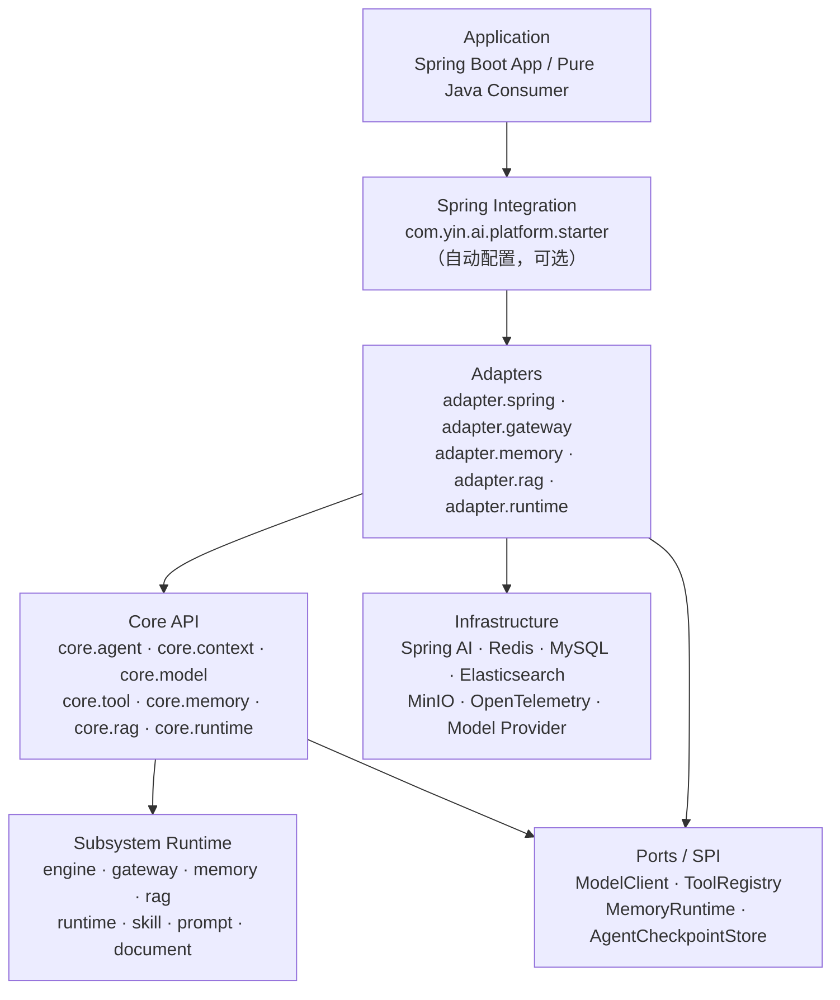

### 2. 运行时请求架构

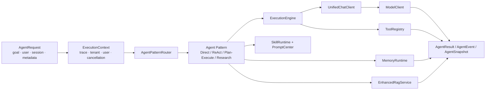

### 3. Agent 生命周期与状态转换

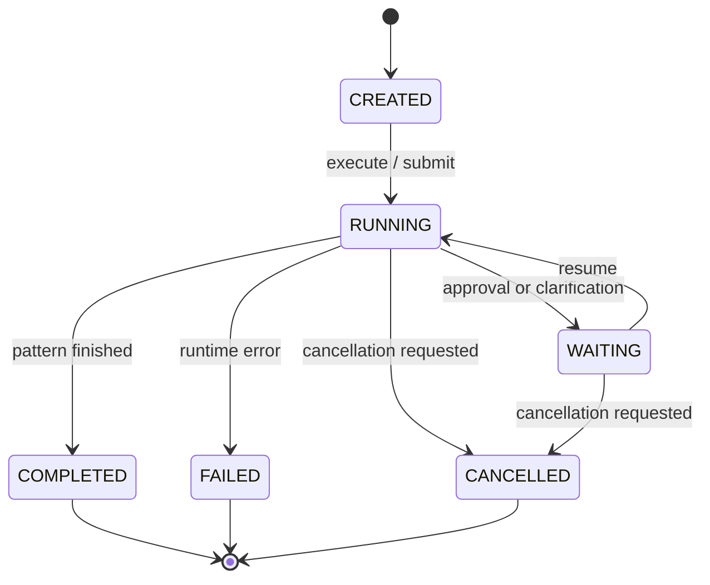

### 4. Agent Pattern 选择

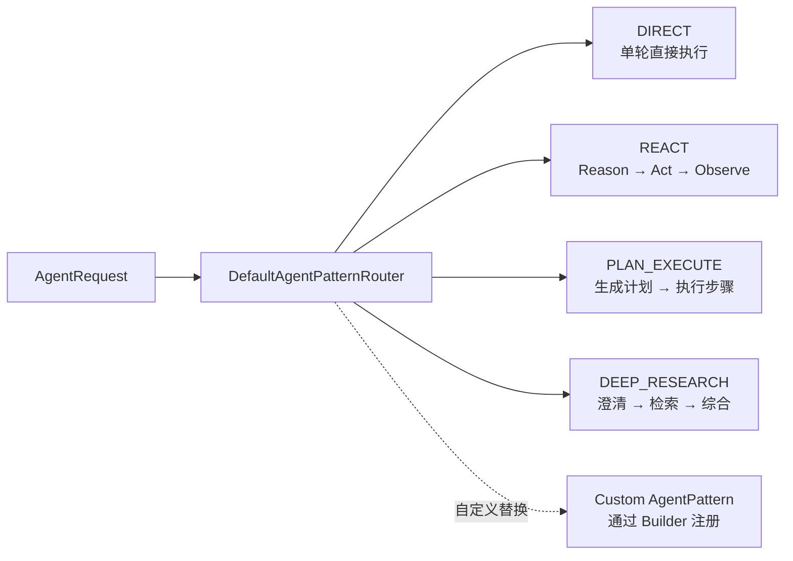

### 5. 异步、暂停和恢复

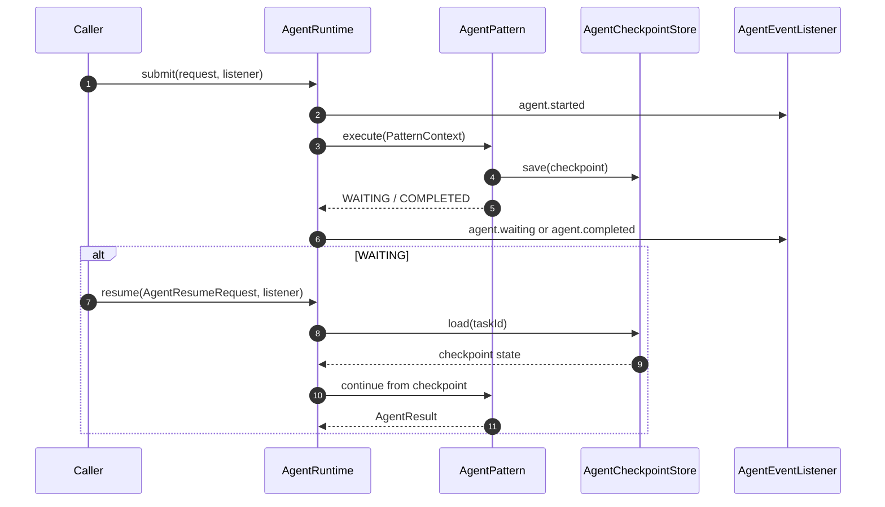

### 6. 组件与外部资源

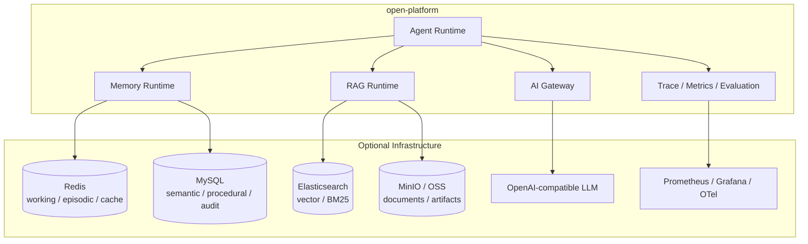

## Core Agent Runtime

com.yin.ai.platform.core.agent.AgentRuntime 是当前推荐的框架无关入口：

| 方法 | 作用 |
| --- | --- |
| execute | 同步执行并返回 AgentResult |
| submit | 异步执行并返回 AgentRun，通过 AgentEventListener 接收事件 |
| resume | 根据 taskId 和恢复请求继续执行 |
| cancel | 请求取消运行中的任务 |
| snapshot | 查询任务状态、模式、变量和检查点摘要 |
| listChildren | 查询子任务快照，供多 Agent 实现扩展 |
| queueInstruction | 向运行中的任务追加用户指令 |

内置模式由 AgentPatternRouter 选择：

| 模式 | 适用场景 | 典型行为 |
| --- | --- | --- |
| DIRECT | 简单、单轮请求 | 直接构造消息并调用模型 |
| REACT | 需要工具和观察结果 | 反复执行 Reason、Act、Observe |
| PLAN_EXECUTE | 多步骤确定性任务 | 生成计划、执行步骤、处理失败策略 |
| DEEP_RESEARCH | 研究、检索和综合 | 澄清问题、检索资料、形成研究结果 |

DefaultAgentRuntime 通过 Builder 注入：

- ModelClient：模型调用端口。
- ToolRegistry：工具定义与执行端口。
- AgentPatternRouter：默认模式选择器。
- AgentCheckpointStore：检查点存储。
- AgentRunStore：任务生命周期、指令、输出和版本状态存储。
- ApprovalPolicy：工具或高风险动作的审批策略。
- ResearchClarifier：Deep Research 的问题澄清器。
- Executor：异步执行器。
- 自定义 AgentPattern：替换或新增模式。

## 快速使用

### 纯 Java

完整示例见 examples/pure-java/PureJavaExample.java。最小调用形态如下：

~~~java
import com.yin.ai.platform.core.agent.AgentRequest;
import com.yin.ai.platform.core.agent.AgentResult;
import com.yin.ai.platform.core.agent.DefaultAgentRuntime;
import com.yin.ai.platform.core.context.ExecutionContext;
import com.yin.ai.platform.core.model.ModelClient;
import com.yin.ai.platform.core.tool.DefaultToolRegistry;

ExecutionContext context = ExecutionContext.create("trace-id")
        .withCaller("my-app")
        .withOperation("agent.execute");

DefaultToolRegistry tools = new DefaultToolRegistry();
ModelClient model = createModelClient();

DefaultAgentRuntime runtime = DefaultAgentRuntime.builder()
        .model(model)
        .tools(tools)
        .build();

AgentRequest request = AgentRequest.of(
        "总结今天的新闻",
        "user-1",
        "session-1",
        context);

AgentResult result = runtime.execute(request);
System.out.println(result.output());
~~~

纯 Java 运行时不要求 ApplicationContext、Spring Bean 或 Spring Boot。ModelClient 是必须由调用方提供的模型适配器；ToolRegistry 也需要注入，可以直接使用 DefaultToolRegistry。

### 流式执行

~~~java
AgentRun run = runtime.submit(request, event -> {
    System.out.println(event.type() + " " + event.payload());
});
AgentResult result = run.completion().toCompletableFuture().join();
~~~

调用方可以使用 run.cancel() 或 runtime.cancel(taskId) 取消任务，也可以使用 runtime.snapshot(taskId) 查询状态。

### 工具注册

~~~java
Tool tool = new Tool() {
    @Override
    public ToolDefinition definition() {
        return new ToolDefinition(
                "get_hot_news",
                "查询热点新闻",
                "1.0.0",
                Map.of(),
                Set.of("news"),
                ToolDefinition.Risk.READ_ONLY);
    }

    @Override
    public ToolResult execute(ToolInput input) {
        return ToolResult.success("news-result");
    }
};

tools.register(tool);
~~~

工具的输入校验、权限、超时、重试、幂等和敏感操作审批应由应用层或治理策略补齐。

## Spring Boot 集成

### 依赖方式

本平台把 Spring 集成（自动配置 + 适配器）打包在同一 artifact 内，Spring Boot 应用直接引入即可：

~~~xml
<dependency>
    <groupId>com.yin</groupId>
    <artifactId>open-platform</artifactId>
    <version>0.0.1-SNAPSHOT</version>
</dependency>
~~~

平台自身把 Spring、模型、Redis、缓存、RAG、PDF、Office、OpenTelemetry 等依赖标记为 optional，
因此**调用方需要按实际使用的适配器显式引入对应依赖**（例如 Spring Web、Redisson、LangChain4j）。
应用侧仍然负责提供模型凭证、数据库、对象存储和安全配置。

### 自动配置

平台在 src/main/resources/META-INF/spring/org.springframework.boot.autoconfigure.AutoConfiguration.imports 中声明自动配置入口。Spring 应用可以：

1. 引入本平台依赖。
2. 配置 Spring AI、Redis、数据库、RAG 和可观测性资源。
3. 使用 ConditionalOnMissingBean 覆盖默认实现。

> 历史上宿主工程曾额外拆出一个 pom 类型的 dependency-only starter 做依赖聚合。
> 独立发布后这层聚合不再必要：需要哪些 Spring 依赖由应用自己声明更清晰。
4. 通过 adapter 包把业务服务的模型、Memory、RAG 和审计实现接入平台。

Agent 运行状态默认使用内存实现，不改变本地开发体验。生产环境已有 RedissonClient 时，可以显式切换到 Redis Adapter：

~~~yaml
ai:
  platform:
    agent-state-store:
      type: redis
      redis-key-prefix: ai:core:agent:
~~~

该开关会同时装配 RedisAgentRunStore 和 RedisAgentCheckpointStore；应用自行提供同类型 Bean 时，自动配置会退让。

### Spring 与 Core 的边界

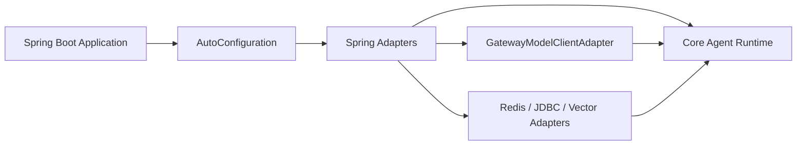

## 核心子系统

### 1. Execution Engine

ExecutionEngine 是平台统一的异步执行边界，提供：

- 同步执行和异步执行。
- 并行任务和失败时的取消。
- 超时、取消和线程池管理。
- 重试策略和退避。
- Reactor Flux 流式事件。
- ExecutionContext 在线程和异步任务之间的传播。

Skill、Function、RAG 和 AI Gateway 不应各自创建线程池；应用应统一配置和使用 ExecutionEngine。

自 v0.0.1 起，执行引擎与流式 packet 生产位于独立模块 `open-platform-engine`：

- `engine.*`：执行引擎、`TaskManager`、超时与取消、分布式并发防护。
- `engine.stream.*`：`StreamPacket`、`SinkStreamProducer`、`StreamMetrics`、`StreamPacketHistoryWriter`。
- `engine.TaskCanceller`：流式生产者只需"能取消任务"这一个能力，不再反向依赖整个
  `TaskManager`；这也消除了两者之间的循环类依赖。

### 2. Memory

MemoryRuntime 是 Agent、Workflow 和 Skill 访问 Memory 的统一门面：

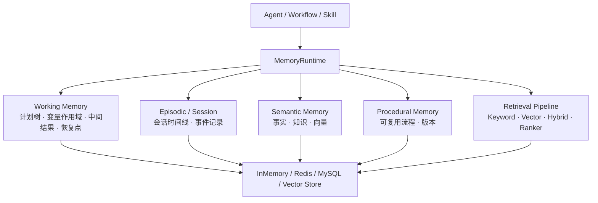

Memory 类型和常见用途：

| 类型 | 典型生命周期 | 用途 |
| --- | --- | --- |
| WORKING | 任务或会话期间 | 计划树、变量、中间结果和恢复点 |
| SESSION | 通常为分钟级 | 对话历史和当前会话上下文 |
| EPISODIC | 通常为天级 | 事件时间线、任务经历和行为记录 |
| SEMANTIC | 长期 | 事实、知识、关系和向量检索 |
| PROCEDURAL | 长期、带版本 | 可复用的任务流程和策略 |

生产环境需要结合租户、用户、TTL、删除、归档、加密和访问策略设计存储实现。

### 3. RAG 与文档管道

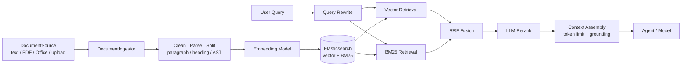

EnhancedRagService 的标准路径是：

1. Query Rewriting：将自然语言问题转换为更适合检索的表达。
2. Multi-Route Retrieval：同时执行向量检索和 BM25 关键词检索。
3. RRF Fusion：按排名融合多路候选，避免不同分数尺度直接比较。
4. Reranking：使用模型对查询和文档相关性进行精排。
5. Context Assembly：按权限、相关性和 token 上限组装上下文。
6. Grounding / Injection：把可信上下文注入 Agent 或模型请求。

任一可选阶段都应有超时和降级策略。文档访问权限必须在检索层和上下文组装层同时控制。

### 4. Skill、Prompt 与 Function

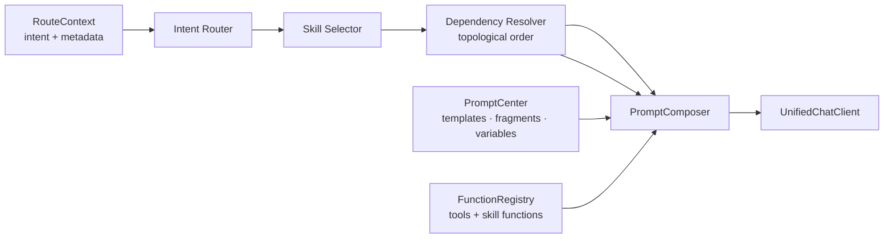

Skill 通常以 classpath Markdown 文件定义 Frontmatter 和 Prompt Body：

~~~yaml
---
name: summary
version: 1.0.0
description: 新闻摘要生成
intent:
  - summarize
dependencies:
  - news-base
rag:
  enabled: true
---
请对输入内容进行摘要，并保留关键事实。
~~~

Prompt Center 支持独立模板、可复用片段和变量定义。AgentSkillFunctionRegistrar 可以把 Skill 暴露为 skill:name 形式的 Function，让 Agent 通过 Function Calling 透明调用 Skill。

### 5. AI Gateway

UnifiedChatClient 是系统内统一的模型调用边界：

- chat：阻塞式调用，返回 GatewayResponse。
- chatStream：流式调用，返回 StreamPacket。
- 过滤器链：重试、Fallback、敏感词、缓存、Trace、Metrics 等。
- 统一记录模型、延迟、Token Usage、成本和工具调用。
- 业务层不应绕过 Gateway 直接持有具体 ChatClient。

### 6. Governance 与 Observability

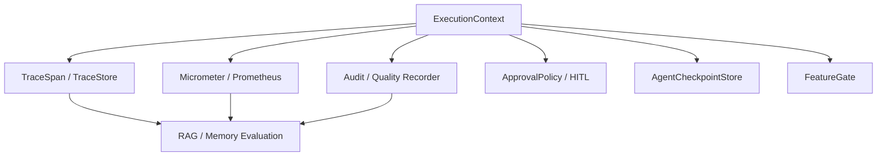

高风险工具、外部写操作、发布动作和敏感数据访问应接入 ApprovalPolicy、审计和可恢复的 CheckpointStore。线上应监控模型成本、P95 延迟、工具失败率、RAG 召回质量、Memory 命中质量和降级次数。

## 扩展点

| 扩展目标 | 实现接口 / 类 | 说明 |
| --- | --- | --- |
| 模型适配器 | core.model.ModelClient | 实现同步和 submit 流式调用 |
| 工具 | core.tool.Tool | 提供 ToolDefinition 和 execute |
| 工具注册 | core.tool.ToolRegistry | 使用 DefaultToolRegistry 或自定义实现 |
| Agent 模式 | core.agent.pattern.AgentPattern | 自定义 mode 和 PatternContext 执行策略 |
| 模式选择 | core.agent.pattern.AgentPatternRouter | 按请求、元数据或规则选择模式 |
| 检查点 | core.agent.checkpoint.AgentCheckpointStore | 保存、加载和删除可恢复状态 |
| 审批 | core.agent.approval.ApprovalPolicy | 决定工具或步骤是否需要人工确认 |
| Memory 存储 | core.memory.api.MemoryRuntime 及 Store SPI | 接入内存、Redis、JDBC 或向量库 |
| Skill 存储 | runtime.SkillRuntime / core.skill.repository.SkillRepository | 接入 classpath、Redis 或远程配置 |
| RAG 数据源 | document.source.DocumentSource / adapter.rag.embedding.DocumentIngestor | 文档解析、清洗、分块和索引 |
| 执行器 | engine.ExecutionEngine | 统一超时、重试、并行和流式执行 |

### 自定义 Agent Pattern

~~~java
public final class ReviewPattern implements AgentPattern {
    @Override
    public AgentMode mode() {
        return AgentMode.REACT;
    }

    @Override
    public PatternResult execute(PatternContext context) {
        // 使用 context.modelClient()、context.toolRegistry()
        // 和 context.eventSink() 实现业务无关的编排策略
        return new PatternResult("review-result", Map.of());
    }
}

DefaultAgentRuntime runtime = DefaultAgentRuntime.builder()
        .model(modelClient)
        .tools(toolRegistry)
        .pattern(new ReviewPattern()) // replaces the built-in REACT pattern
        .build();
~~~

当前 AgentMode 是固定枚举。自定义 Pattern 可以替换现有模式；如果新增模式，则需要同时扩展 AgentMode、路由器、任务事件、检查点和失败策略，并补充完整测试。

## 配置与依赖

### Maven 构建

在项目根目录执行：

~~~bash
mvn -DskipTests package
~~~

平台 POM 中的 Spring、模型、Redis、缓存、RAG、PDF、Office、OpenTelemetry 等运行依赖大多标记为 optional；调用方应按使用的适配器显式引入所需依赖。

### 配置区域参考

宿主应用（以及任何 Spring Boot 消费方）通常在这些前缀下配置平台能力：

| 配置区域 | 作用 |
| --- | --- |
| ai.engine | 默认超时、LLM 超时、Function 超时、重试和线程池 |
| ai.gateway | 默认模型、温度、最大 Token、过滤器和思考模式 |
| ai.memory | TTL、编排、检索、写入、归档和 Consolidation |
| ai.rag / ai.knowledge | Elasticsearch、Embedding、索引和上下文上限 |
| ai.skill | intent 到 Skill 的映射 |
| ai.observability | Trace 和在线检索质量采样 |
| ai.feature | 流式、检查点、异步、配额和并发开关 |

敏感配置应通过环境变量或部署平台 Secret 注入，不要提交 API Key、数据库密码和对象存储凭证。

## 模块划分

多模块结构按依赖方向自下而上排列，整体是一条单向 DAG：

```text
core ─┬─> document ──────┐
      ├─> security ──┬───┤
      ├─> rollout ───┤   │
      │              ├─> engine ─┐
      └─> quickstart ┘           ├─> platform ─┬─> legacy
                                 │             └─> server
                                 └─────────────┘
```

准确说明：`engine` 依赖 `core` + `security`（流式缓冲配置）；`platform` 依赖
`core` / `document` / `security` / `rollout` / `engine`。

| 模块 | Maven 坐标 | 内容 | 文件 | 测试 |
| --- | --- | --- | ---: | ---: |
| Core | `com.yin:open-platform-core` | 框架无关的契约：Agent Runtime、四种编排 pattern、Model/Tool/Memory/RAG 端口、ExecutionContext；另含最简身份类型 | 175 | 120 |
| Document | `com.yin:open-platform-document` | 文档解析（PDF/DOCX/XLSX/PPTX/HTML/Markdown/TXT）、清洗、分块、AST | 56 | 103 |
| Security | `com.yin:open-platform-security` | JWT 过滤、敏感词 DFA、内部 API HMAC、Security 过滤链、Feature Flag | 15 | — |
| Rollout | `com.yin:open-platform-rollout` | 灰度开关 | 2 | 1 |
| **Engine** | `com.yin:open-platform-engine` | 执行引擎、超时与取消、任务管理、分布式并发防护；流式 packet 生产（`SinkStreamProducer` / `StreamMetrics` / `StreamPacket`） | 19 | 10 |
| Quickstart | `com.yin:open-platform-quickstart` | 业务门面 `Agent` / `Result` / `ModelClients` | 3 | 8 |
| Platform | **`com.yin:open-platform`** | Agent 编排、Gateway、Memory、RAG、Function、Prompt、Workflow、Observability、Adapters | 643 | 1056 |
| Legacy | `com.yin:open-platform-legacy` | V1 → V2 迁移桥 | 2 | — |
| Server | `com.yin:open-platform-server` | Spring Boot 自动配置入口（`AutoConfiguration.imports`） | 10 | 21 |

> 依赖 `com.yin:open-platform` 会传递带入 core / document / security / rollout / engine。

**作为消费者该引入哪个：**

~~~xml
<!-- 普通 Java / 需要门面 -->
<dependency>
    <groupId>com.yin</groupId>
    <artifactId>open-platform</artifactId>
    <version>0.0.1-SNAPSHOT</version>
</dependency>
<dependency>
    <groupId>com.yin</groupId>
    <artifactId>open-platform-quickstart</artifactId>
    <version>0.0.1-SNAPSHOT</version>
</dependency>
~~~

~~~xml
<!-- Spring Boot 应用：自动配置会传入 core / platform / quickstart -->
<dependency>
    <groupId>com.yin</groupId>
    <artifactId>open-platform-server</artifactId>
    <version>0.0.1-SNAPSHOT</version>
</dependency>
~~~

## 目录结构

~~~text
open-platform/
├── pom.xml                     # 父 POM（packaging=pom，统一版本与插件）
├── README.md
├── architecture-overview.md
├── config/checkstyle/          # 可选 lint 配置（-Plint）
├── examples/
│   ├── pure-java/              # 无 Spring 的最小用法
│   └── code-qa/                # 真实消费者：代码库问答助手（含 CLI 与测试）
├── core/src/main/java/
│   ├── com/yin/ai/platform/
│   │   ├── core/               # canonical API、上下文、模型、工具、四种 pattern
│   │   └── exception/
│   ├── com/yin/domain/         # 身份类型（LoginUser / User）
│   └── com/yin/security/util/  # GetLoginUserUtil / UserContext / InternalApiSignUtils
├── document/src/main/java/com/yin/ai/platform/document/
├── security/src/main/java/
│   ├── com/yin/ai/platform/{filter,config}/
│   └── com/yin/security/filter/          # InternalApiFilter
├── rollout/src/main/java/com/yin/ai/platform/rollout/
├── engine/src/main/java/com/yin/ai/platform/engine/
│   ├── *                       # 执行引擎、任务管理、超时与取消、TaskCanceller 端口
│   ├── bridge/  config/        # Reactor 上下文桥接、并发防护、Spring 配置
│   └── stream/                 # StreamPacket、SinkStreamProducer、StreamMetrics
├── quickstart/src/main/java/com/yin/ai/platform/quickstart/
├── platform/src/main/java/com/yin/ai/platform/
│   ├── agent/                  # Agent 编排及历史兼容 API
│   ├── gateway/                # 统一模型调用和 Gateway Filter Chain
│   ├── memory/                 # Memory Runtime、检索、策略和观测
│   ├── rag/                    # RAG、触发策略、grounding 和评测
│   ├── function/               # Function Registry 与调用协议
│   ├── runtime/                # Skill Runtime 和运行时适配
│   ├── prompt/                 # Prompt Center、模板、片段和变量
│   ├── observe/                # Trace、Metrics、质量和评测
│   ├── workflow/               # 工作流步骤和执行上下文
│   ├── adapter/                # Spring、Redis、JDBC、向量库等基础设施适配器
│   ├── structured/             # 结构化输出
│   └── knowledge/              # 知识库接入
├── platform/src/main/resources/prompts/   # Prompt 变量和片段
├── legacy/src/main/java/com/yin/ai/platform/legacy/
└── server/
    ├── src/main/java/com/yin/ai/platform/starter/
    └── src/main/resources/META-INF/spring/  # AutoConfiguration imports
~~~

## 构建、测试与示例

### 编译与单元测试

~~~bash
# 编译全部模块
mvn -DskipTests package

# 运行全部模块的单元测试（当前 1319 个）
mvn test

# 只构建某个模块及其上游依赖
mvn -pl platform -am test

# 完整校验（需 -Pcoverage 才产出 jacoco 数据）
mvn verify
~~~

各模块的测试分布：`core` 120、`document` 103、`platform` 1056、`server` 21、
`engine` 10、`quickstart` 8、`rollout` 1（合计 1319）。

### 纯 Java Smoke Test

examples/pure-java 用 MockModelClient 验证：

- Core API 不要求 Spring。
- ExecutionContext 可以携带 caller、operation 和 trace。
- DefaultToolRegistry 可以在容器外注册工具。
- DefaultAgentRuntime 可以完成最小 Agent 执行。
- 平台基础设施依赖不应把 Spring 带入纯 Java classpath。

~~~bash
mvn install -DskipTests
mvn -f examples/pure-java/pom.xml verify
~~~

### 真实消费者示例（code-qa）

examples/code-qa 是一个与新闻领域无关的独立消费者（代码库问答助手），
它同时承担「平台抽象是否成立」的验收职责，并可在离线 STUB 模型下于 CI 运行：

~~~bash
mvn install -DskipTests
mvn -f examples/code-qa/pom.xml verify
~~~

Windows 下也可直接运行 `examples\code-qa\run.cmd`。详见 [examples/code-qa/README.md](examples/code-qa/README.md)。

### 覆盖率门禁

项目配置了行覆盖率和分支覆盖率基线：

~~~bash
mvn verify -Pcoverage-gate
~~~

> 覆盖率默认关闭。JaCoCo agent 在非 ASCII 路径（例如中文用户名的桌面目录）下会因
> destfile 编码问题导致 `-javaagent` 加载失败、测试 fork 崩溃；因此需要覆盖率时
> 必须显式加 `-Pcoverage` 或 `-Pcoverage-gate`。

### 质量检查

~~~bash
# 可选 lint：继承宿主工程的 checkstyle 配置，存量违规未清理，只报告不阻塞
mvn -Plint verify

mvn test
git diff --check
~~~

## 兼容性与迁移

### 与宿主工程解耦（内联的类型）

本项目原本是 `wkc-news-cloud` 多模块工程中的一个模块，通过 `wkc-common` 获取身份与安全类型。
独立出来后，为保持「不依赖宿主工程任何模块」，以下 6 个类型已内联进本项目：

| 类型 | 包 | 说明 |
| --- | --- | --- |
| `LoginUser` | `com.yin.domain` | 登录用户，实现 Spring Security `UserDetails` |
| `User` | `com.yin.domain` | 通用用户模型；**已移除 MyBatis-Plus `@TableName`**，平台不再依赖 ORM |
| `GetLoginUserUtil` | `com.yin.security.util` | 从 SecurityContext 读取当前用户 |
| `UserContext` | `com.yin.security.util` | 基于 `ScopedValue` 的用户上下文 |
| `InternalApiSignUtils` | `com.yin.security.util` | 内部 API 的 HMAC-SHA256 签名 |
| `InternalApiFilter` | `com.yin.security.filter` | `/internal/**` 签名校验过滤器 |

包名保持不变，因此原宿主工程的迁移成本为零：只要名字与版本对得上，依赖替换即可。

副作用：该 6 个类原本的传递依赖（hutool、sentinel-core、jjwt、hibernate-validator、
uap-java、commons-pool2 等）随之从依赖树中消失。已确认平台代码**没有**引用它们
（Sentinel 仅作为 ArchUnit 的禁用包名字符串出现），因此这是依赖面的净减少。

### 刻意保留的历史标识符

以下标识符仍然带 `wkc-` 前缀，**属于有意保留，不是遗漏**。它们要么是持久化/可观测侧的
外部契约，要么是运行时开关，改名会造成兼容性破坏：

| 位置 | 标识符 | 改名的后果 |
| --- | --- | --- |
| `RAGProperties` | 默认 ES 索引 `wkc-documents` | 与既有索引不匹配，检索直接空结果 |
| `ElasticsearchMemorySearchService` | 索引 `wkc-memory-cells` | 记忆检索历史数据读不到 |
| `ElasticsearchTraceStore` | 索引 `wkc-trace-spans` | 已有 Trace 数据不可查 |
| `PlanToolGenerator` | 系统属性 `wkc.agent.planner.toolCall` | 现有部署的开关失效 |
| `AiTracingService` / `AgentPatternConfiguration` | Tracer 名 `wkc-ai-platform*` | 监控面板与指标名断裂 |

如确需改名，应当作为一次显式的破坏性变更处理：同时提供配置项覆盖与数据迁移方案。

### 两套 API 表面

平台当前存在两套 API 表面：

| API | 定位 | 建议 |
| --- | --- | --- |
| com.yin.ai.platform.quickstart.* | 面向业务开发者的极简门面（`Agent` / `Result`） | **业务代码首选**，无需了解平台内部概念 |
| com.yin.ai.platform.core.* | 框架无关的 canonical API | 需要精细控制时使用 |
| com.yin.ai.platform.agent.* | 历史 Agent Runtime、Planner、Reflector、HITL 和适配 API | 维护现有业务，逐步迁移 |
| com.yin.ai.platform.adapter.runtime.persistence.* | Agent 状态、任务上下文、Token 与 HITL 的 Redis 实现 | 基础设施实现从此包接入 |
| com.yin.ai.platform.adapter.runtime.event.* | Redis 事件日志、重放游标与实时事件分发 | Runtime 基础设施，不包含 HTTP 类型 |
| com.yin.ai.platform.adapter.spring.web.* | SSE/HTTP 传输与 Spring Security 接入 | 仅 Spring Web 消费者使用 |

迁移原则：

1. 新代码从 core.agent.AgentRuntime、core.context.ExecutionContext、core.model.ModelClient 和 core.tool.ToolRegistry 开始。
2. 将业务服务中的模型调用集中到 UnifiedChatClient 或 ModelClient 适配器。
3. 将旧 AgentContext、AgentTask、Planner 和 Reflector 的业务依赖收敛到 adapter 层。
4. 保留事件、任务 ID、Trace、Memory 和审批语义，避免只替换类名而丢失治理能力。
5. 为迁移路径增加兼容性测试和架构测试。

历史 `DefaultTaskEngine`、`RedisContextStore`、`RedisTaskTokenAccountant` 和
`RedisHitlStore` 类暂时保留为 deprecated 兼容壳；Spring 配置已经直接创建
`adapter.runtime.persistence` 中的实现，新代码不应再引用这些旧入口。

历史 `DualWriteEventPublisher` 和 `AgentSseController` 同样只保留 deprecated
兼容入口；Redis 事件日志现由 `adapter.runtime.event.RedisAgentEventPublisher`
负责，SSE 路由由 `adapter.spring.web.AgentSseController` 提供，原 HTTP 路径与
Last-Event-ID 协议保持不变。

## 生产使用检查清单

- [ ] 为 ModelClient、Tool、Skill 和 MCP 工具配置明确的权限边界。
- [ ] 为高风险写操作启用 ApprovalPolicy、HITL 和审计。
- [ ] 生产环境启用 Redis AgentRunStore 和 AgentCheckpointStore，或提供自定义持久化实现。
- [ ] 为任务、事件、Artifact、Memory 和 RAG 文档设计租户/用户隔离。
- [ ] 为模型调用、工具调用、RAG 检索和 Memory 召回配置超时与降级。
- [ ] 为 Redis、MySQL、Elasticsearch、MinIO 和模型 API 配置连接池、凭证和健康检查。
- [ ] 监控 token、成本、延迟、错误率、取消率、工具失败率和检索质量。
- [ ] 对 Prompt、Skill、模型和 Feature Flag 做版本管理与回滚。
- [ ] 对上传文档、外部网页、MCP 资源和模型输出执行大小、类型和内容安全限制。
- [ ] 通过离线数据集和在线采样持续评估 RAG/Memory 质量。

## 已知限制

- 默认 DefaultAgentRuntime 使用内存运行状态和内存检查点，适合开发与测试；可显式切换到 Redis Adapter。
- Core Runtime 的多 Agent 子任务管理接口保留扩展边界，具体任务持久化和配额由消费方应用负责。
- RAG、Memory、Redis、Elasticsearch、MinIO 和模型能力均为可选基础设施，不配置时应使用明确的降级实现。
- 历史 agent 包和 Core API 同时存在，部分业务仍处于迁移阶段；请避免在新模块继续扩大旧 API 的直接依赖。
- 版本升级应同时检查 Spring Boot / Spring AI 兼容性、配置格式和外部向量库索引。
- 覆盖率采集默认关闭（见[构建、测试与示例](#构建测试与示例)），需 `-Pcoverage` 显式开启。

## 贡献与许可证

欢迎提交 Issue、文档改进和 Pull Request。提交前请：

- 使用 Java 21，并遵循项目 Checkstyle。
- 为新增能力补充单元测试、架构测试或可控的集成测试。
- 说明 SPI、线程、超时、重试、权限、租户、成本和降级行为。
- 不提交 .env、密钥、target、日志和本地 IDE 文件。
- 保持 Core API 不依赖业务服务和具体基础设施。

完整架构设计见 [architecture-overview.md](architecture-overview.md)，项目许可证见 [../LICENSE](../LICENSE)。

Copyright (c) 2026 whosayyyy.
